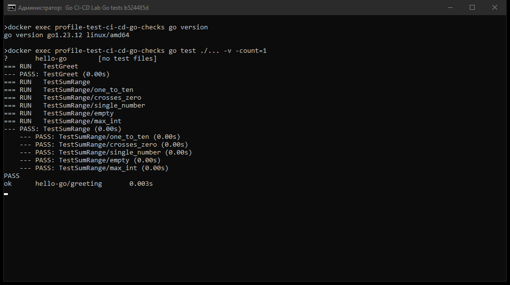
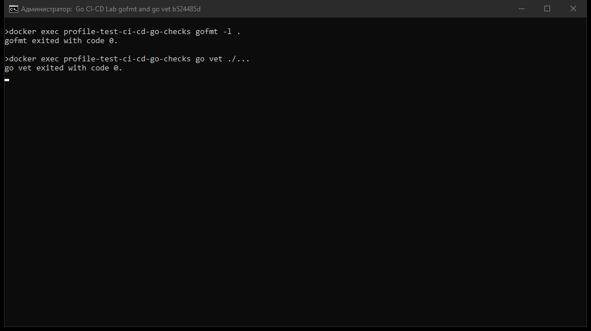
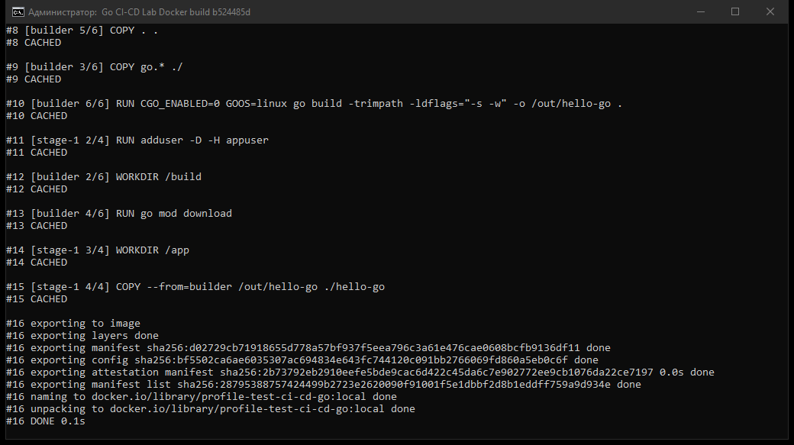
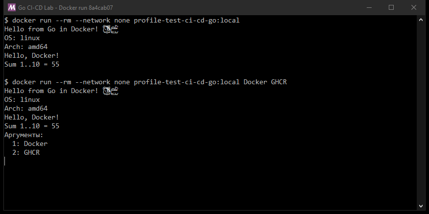

# CI/CD на Go с публикацией Docker-образа в GHCR

Цель практики — проверить Go-приложение, упаковать его в Docker-образ и подготовить автоматическую доставку образа в GitHub Container Registry. Программа выводит приветствие, сумму чисел от 1 до 10, сведения о платформе и переданные аргументы. [Методичка преподавателя](https://github.com/rurewa/imfua/blob/main/content/DevOps/CI_CD/Pipelines/CI_CD_Go.md)

## Структура проекта

| Файл или каталог | Назначение |
| --- | --- |
| `go.mod` | Модуль `hello-go` на Go 1.23. |
| `main.go` | Точка входа и вывод в консоль. |
| `greeting/greeting.go` | Функции `Greet` и `SumRange`. |
| `greeting/greeting_test.go` | Тесты приветствия и суммы, включая пустой диапазон и верхнюю границу `int`. |
| `Dockerfile` | Сборка статического Linux-бинарника в `golang:1.23-alpine` и запуск в `alpine:3.24` от `appuser`. |
| `.github/workflows/ci.yml` | Workflow для корня отдельного репозитория `hello-go`. |
| `.gitignore`, `.dockerignore` | Исключения для локальных файлов и ограничение контекста сборки исходниками Go. |
| `screenshots/` | Снимки локальных проверок. |

## Как работают CI и CI/CD

CI проверяет форматирование, запускает `go vet` и тесты, собирает Go-бинарник и Docker-образ. При pull request Docker-образ собирается для проверки. При push в `main` отдельное задание начинается после успешных проверок Go, собирает Docker-образ и отправляет его в GHCR. Публикация образа добавляет к CI этап доставки артефакта. [Публикация Docker-образов в GitHub Actions](https://docs.github.com/en/actions/tutorials/publish-packages/publish-docker-images)

Версию Go задаёт `go.mod`. Action `setup-go` использует этот файл и как ключ кэша, поскольку проект использует стандартную библиотеку. Workflow настроен на GitHub-hosted runner `ubuntu-latest`. Go 1.23 сохранён для учебного задания. Эта ветка уже вышла из срока поддержки Go. [Настройка Go и кэша в actions/setup-go](https://github.com/actions/setup-go/tree/v7) · [Политика поддержки Go](https://go.dev/doc/devel/release#policy)

## Локальные проверки в Windows PowerShell

Запустите Docker Desktop в режиме Linux-контейнеров. Команды выполняются из корня `hello-go`. Go запускается во временном контейнере, исходники монтируются только для чтения, бинарник сборки остаётся внутри контейнера.

~~~powershell
$source = (Resolve-Path -LiteralPath .).Path
$checks = 'profile-test-ci-cd-go-checks'

docker run -d --rm --name $checks --network none --env CGO_ENABLED=0 --env GOTOOLCHAIN=local --mount "type=bind,source=$source,target=/app,readonly" --workdir /app golang:1.23-alpine tail -f /dev/null
if ($LASTEXITCODE -ne 0) { throw 'Не удалось запустить временный контейнер Go.' }

try {
    docker exec $checks go version
    $unformatted = docker exec $checks gofmt -l .
    if ($LASTEXITCODE -ne 0 -or $unformatted) { throw "Проверка gofmt не прошла. $unformatted" }
    Write-Output 'gofmt: OK'

    docker exec $checks go vet ./...
    if ($LASTEXITCODE -ne 0) { throw 'Проверка go vet не прошла.' }

    docker exec $checks go test ./... -v
    if ($LASTEXITCODE -ne 0) { throw 'Тесты не прошли.' }

    docker exec $checks go build -trimpath -o /tmp/hello-go .
    if ($LASTEXITCODE -ne 0) { throw 'Сборка Go-бинарника не прошла.' }
} finally {
    docker stop $checks
}
~~~

## Сборка и запуск Docker-образа

~~~powershell
docker build --progress plain --tag profile-test-ci-cd-go:local .
docker run --rm --network none profile-test-ci-cd-go:local
docker run --rm --network none profile-test-ci-cd-go:local Docker GHCR
~~~

Первый запуск печатает `OS: linux`, архитектуру контейнера, `Hello, Docker!` и `Sum 1..10 = 55`. Второй добавляет список аргументов `Docker` и `GHCR`. Программа завершает работу после вывода, а `--rm` удаляет временный контейнер.

## Результаты локальных проверок

- Проверки выполнялись на Go `1.23.12` в Linux-контейнере. `gofmt -l .` не вывел ни одного файла, `go vet ./...` завершился успешно.
- `go test ./... -v` успешно выполнил `TestGreet`, `TestSumRange` и все пять случаев для суммы. `go build` создал исполняемый файл.
- Docker собрал образ `profile-test-ci-cd-go:local`. Контейнер запустился от `appuser`, вывел `OS: linux`, `Arch: amd64`, `Hello, Docker!` и `Sum 1..10 = 55`. Повторный запуск вывел оба аргумента.
- Локальный разбор YAML подтвердил события `push` в `main` и `pull_request`, команды CI, условие публикации после `ci`, использование `GITHUB_TOKEN` и теги `latest` и короткий SHA.

## Скриншоты локальных проверок

### Тесты Go

### Форматирование и go vet

### Сборка Docker-образа

### Запуск контейнера

## GitHub Actions и публикация в GHCR

Workflow хранится в корне репозитория по пути [.github/workflows/ci.yml](.github/workflows/ci.yml). GitHub Actions запускает его при pull request и при push в `main`.

Проверка опубликованного образа:

1. В разделе **Actions** откройте запуск **Go CI/CD** для этого коммита. Проверьте успешное завершение заданий **Check Go and Docker** и **Build and publish to GHCR**.
1. Откройте **Packages → hello-go**. Сверьте теги `latest` и короткий SHA коммита с результатами запуска. Для публикации workflow использует встроенный `GITHUB_TOKEN` с `packages: write` в задании публикации. [GitHub Container Registry](https://docs.github.com/en/packages/working-with-a-github-packages-registry/working-with-the-container-registry)
1. После публикации проверьте образ под учётной записью с доступом к пакету. Для публичного пакета эти команды работают без входа в GHCR.

~~~powershell
$ghcrOwner = (Read-Host 'Владелец репозитория hello-go').ToLowerInvariant()
$remoteImage = "ghcr.io/$ghcrOwner/hello-go:latest"
docker pull $remoteImage
docker run --rm $remoteImage
~~~

Результаты локальных проверок приведены выше. Статус отправки образа можно проверить в Actions и Packages. Видимость пакета настраивается отдельно.
